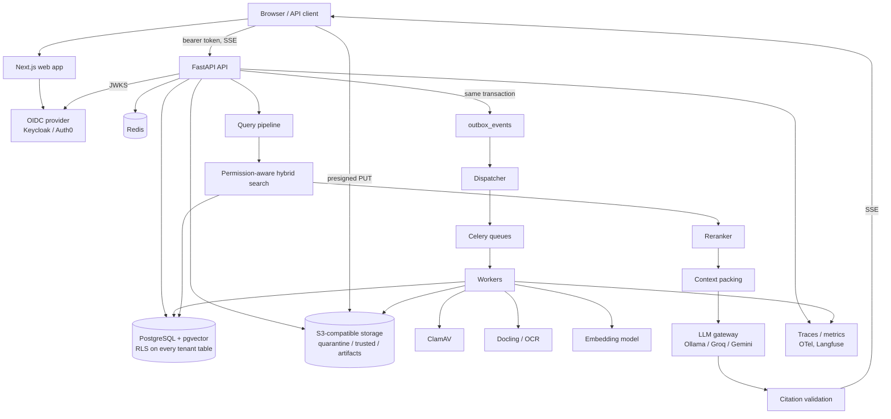
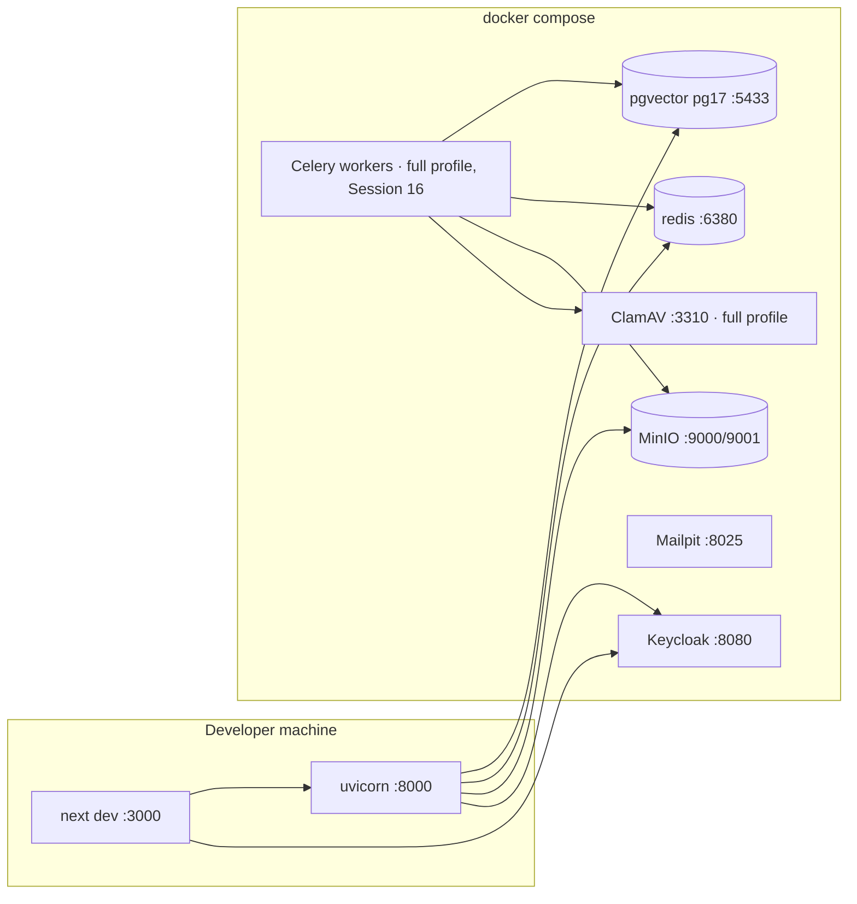
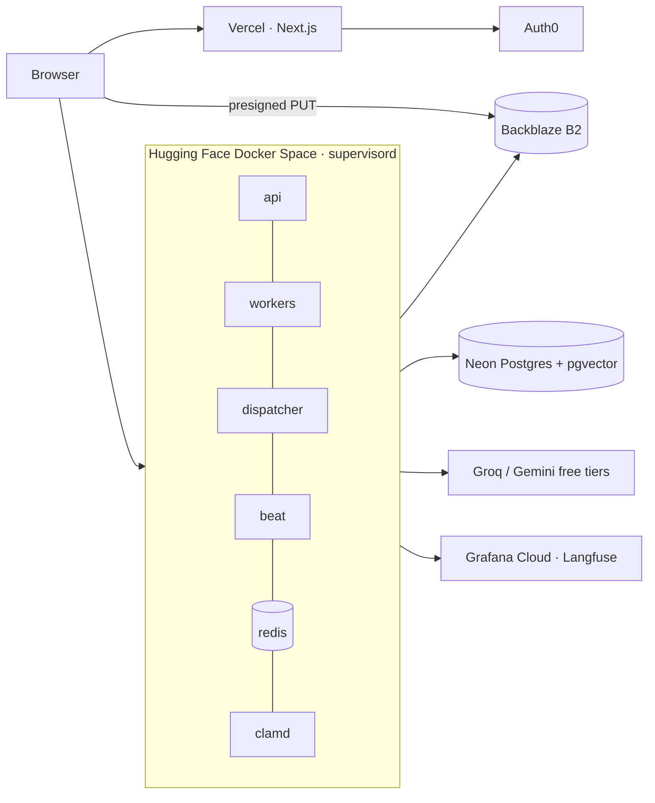

# Architecture overview

KnowledgeOS is a **modular monolith** (ADR-001): one FastAPI backend plus Celery workers sharing one codebase and one PostgreSQL database, and a Next.js frontend. Full specification: [`plan.md`](../../plan.md).

## System view

## Request path rules

1. Authenticate (OIDC JWT) → resolve organization membership → set transaction-local tenant context (ADR-003, ADR-004).
2. Authorize **before** any retrieved content reaches a model; authorization filters are part of the retrieval SQL (ADR-002).
3. Retrieved content is untrusted data, delimited as evidence, never instructions.
4. Providers are reached only through policy-checked interfaces (ADR-006).
5. No DB transaction stays open while an LLM streams.

## Deployment views

### Local development (Docker Compose)

### Free-tier deployment (ADR-008)

### Enterprise reference (documented, not deployed)

The same backend image runs each role as a separate service (ECS/Kubernetes), with managed PostgreSQL, Redis, S3, KMS, WAF and private networking — see plan.md §38.3 and the Terraform reference module (Session 60).
